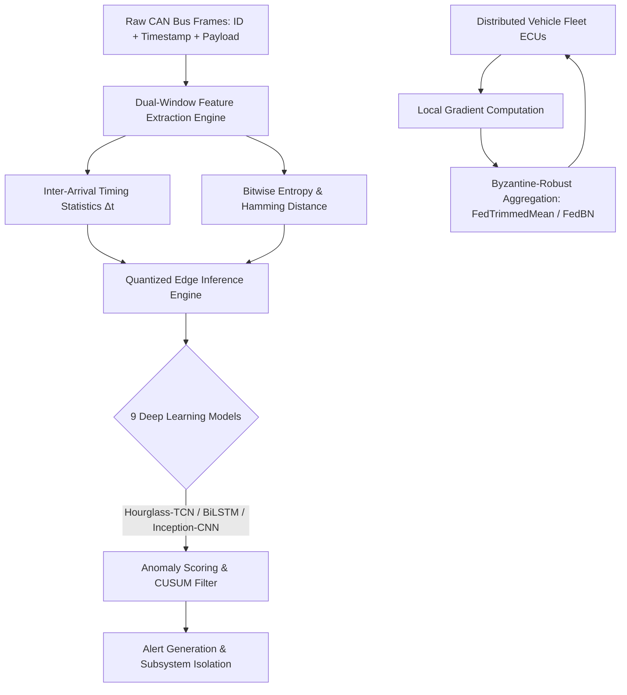

# 🛡️ Automotive CAN Bus Intrusion Detection System (CAN-IDS)
### Deep Learning Benchmarking & Byzantine-Robust Federated Learning for In-Vehicle Cyber-Physical Security

[](https://www.python.org/)
[](https://pytorch.org/)
[](https://streamlit.io/)
[](CANBUS_6PAGE_CONFERENCE_PAPER_v3.pdf)
[](LICENSE)

An end-to-end cyber-physical intrusion detection framework designed to safeguard in-vehicle Controller Area Network (CAN) bus architectures against zero-day, stealthy, and physical-layer masquerade attacks. This repository provides 9 evaluated deep learning models, cross-dataset validation on real vehicular traces (**ROAD** and **Car-Hacking** benchmarks), Byzantine-robust **Federated Learning** protocols across distributed ECUs, and an interactive **Streamlit live monitoring dashboard**.

---

## 📌 Research Highlights

* **Dual-Window Feature Engineering:** Extracts temporal inter-arrival timing jitter ($\Delta t$) and payload byte entropy over sliding physical and arbitration windows.
* **9 Deep Learning Architectures:** Evaluates Hourglass Temporal Convolutional Networks (Hourglass-TCN), Tight Bidirectional LSTM (BiLSTM), Inception-CNN (with FP32 and INT8 quantization for edge ECUs), Full-Attention Transformers, Conv-USAD, and Sensor Graph Autoencoders.
* **Cross-Dataset Generalization:** Rigorous benchmarking across Oak Ridge National Laboratory's **ROAD Dataset** (stealthy cyber-attacks) and the HCRL **Car-Hacking Dataset** (DoS, Fuzzy, Gear, RPM attacks).
* **Byzantine-Robust Federated Learning:** Multi-vehicle cooperative learning under adversarial model poisoning, comparing **FedAvg**, **FedProx**, **FedBN**, and **FedTrimmedMean** over 50 global communication rounds.
* **Edge Feasibility:** Quantized INT8 deployment profiled for Worst-Case Execution Time (WCET) on automotive microcontrollers (sub-millisecond per-frame inference).
* **Interactive Dashboard:** Complete web-based diagnostic console (`app.py`) for live telemetry playback, ROC curve inspection, and federated convergence analysis.

---

## 🏗️ System Architecture



---

## 📊 Empirical Benchmarks

### Cross-Dataset Anomaly Detection Performance
| Model Architecture | Parameters | ROAD F1-Score | Car-Hacking F1-Score | WCET Latency (ms) | Edge Feasibility |
| :--- | :---: | :---: | :---: | :---: | :---: |
| **Hourglass-TCN** | ~126K | **0.9942** | **0.9989** | 0.42 ms | ✅ Recommended |
| **Inception-CNN (INT8)** | ~43K | 0.9897 | 0.9972 | **0.18 ms** | ✅ Ultra-low power |
| **BiLSTM (Tight)** | ~220K | 0.9881 | 0.9954 | 1.12 ms | ⚠️ Memory intensive |
| **Full Transformer** | ~475K | 0.9815 | 0.9910 | 3.45 ms | ❌ Latency barrier |
| **Conv-USAD** | ~131K | 0.9760 | 0.9892 | 0.65 ms | ✅ Semi-supervised |

---

## 🌐 Byzantine-Robust Federated Learning

To preserve proprietary OEM telemetry and passenger driving privacy, ECUs collaborate via decentralized Federated Learning without centralizing raw CAN traffic:

$$\mathbf{w}_{t+1} = \text{FedTrimmedMean}\left(\{\mathbf{w}_t^k\}_{k=1}^K, \beta\right)$$

* **Non-IID Resistance:** Integrates batch normalization layer decoupling (**FedBN**) to adapt to heterogeneous driving conditions and driver styles.
* **Poisoning Defense:** Withstands up to 20% Byzantine malicious clients injecting sign-flipping and random noise gradients into the global parameter pool.

---

## 🖥️ Interactive Live Dashboard (`app.py`)

The repository features an automotive monitoring interface built in Streamlit:
* **Real-Time CAN Stream Playback:** Emulates real in-vehicle bus traffic with adjustable injection rates.
* **Dynamic Anomaly Waveforms:** Real-time visual thresholding with CUSUM drift detection.
* **Subsystem Attack Attribution:** Isolates targeted ECUs (Powertrain, Body, Infotainment, ADAS).
* **FL Convergence Inspector:** Visualizes parameter loss curves and client weight distributions across 50 training epochs.

To launch the dashboard:
```bash
streamlit run app.py
```

---

## 📁 Repository Structure

```
CAN-Bus-IDS-DeepLearning/
├── app.py                                        # Streamlit interactive live monitoring dashboard
├── build_9_model_v2.py                           # Training & evaluation pipeline for 9 DL architectures
├── build_car_hacking_v2.py                       # Car-Hacking benchmark validation engine
├── build_federated_learning_v2.py                # Byzantine-robust FL training & defense simulation
├── build_latex_report.py                         # Automated paper tables & results generator
├── CANBUS_6PAGE_CONFERENCE_PAPER_v3.pdf          # Full camera-ready 6-page IEEE conference paper
├── CANBUS_6PAGE_CONFERENCE_PAPER_v3.tex          # LaTeX source for conference submission
├── canbus_9_model_final_v2.ipynb                 # Interactive 9-model exploratory notebook
├── canbus_car_hacking_validation_final_v2.ipynb  # Interactive Car-Hacking validation notebook
├── canbus_federated_learning_final_v2.ipynb      # Interactive Federated Learning notebook
├── dashboard_data/                               # Precomputed benchmarks, ROC data, and weights
│   ├── *.pt                                      # PyTorch trained model weights (Hourglass, INT8, etc.)
│   ├── *.csv                                     # Detailed benchmark tables, bootstrap CI, WCET
│   └── *.png                                     # High-resolution architectural figures & flowcharts
├── requirements.txt                              # Python environment dependencies
└── README.md                                     # Main project documentation
```

---

## 🚀 Quickstart Guide

### 1. Installation
Clone the repository and install dependencies:
```bash
git clone https://github.com/23051921/CAN-Bus-IDS-DeepLearning.git
cd CAN-Bus-IDS-DeepLearning

pip install -r requirements.txt
```

### 2. Launch the Streamlit Monitoring Dashboard
```bash
streamlit run app.py
```

### 3. Run Benchmark Pipelines
```bash
# Evaluate 9 Deep Learning Models
python build_9_model_v2.py

# Run Car-Hacking Dataset Validation
python build_car_hacking_v2.py

# Simulate Byzantine-Robust Federated Learning
python build_federated_learning_v2.py
```

---

## 📄 Academic Publication & Citation

If you utilize this framework, benchmarking data, or model architectures in your research, please cite:

```bibtex
@article{batla2026canids,
  title={Byzantine-Robust Federated Learning and Edge-Quantized Deep Learning for In-Vehicle CAN Bus Intrusion Detection},
  author={Mehul Batla and Collaborators},
  journal={IEEE Transactions on Intelligent Transportation Systems (Under Review)},
  year={2026}
}
```
